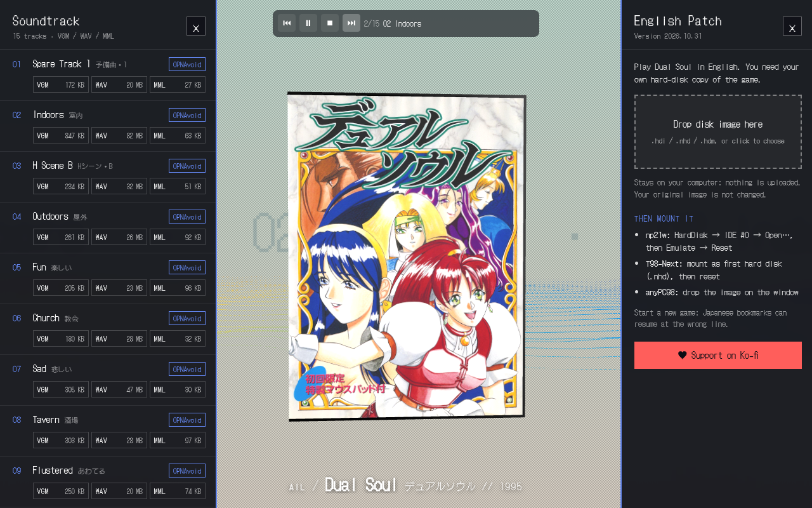

# Dual Soul EN

3D box viewer for **Dual Soul** (AIL, 1995, PC-98), with the soundtrack and the English translation patch.

**[Open the site](https://delacannon.github.io/dual-soul-en/)** (18+)



- 3D box: drag to orbit, wheel to zoom, `Space` to turn it, `L` to switch lighting
- Soundtrack player with a spectrum that reacts to the music
- 15 tracks to download as VGM, WAV and MML, each one opens in OPNAvoid
- English patch: drop your own `.hdi` / `.nhd` on the page, a patched copy is saved. Nothing is uploaded and your original is not changed

The patch contains no game data: you need your own copy of the game.

## Run it

```sh
pnpm install --ignore-workspace
pnpm dev
```

The built site lives on the `gh-pages` branch.
